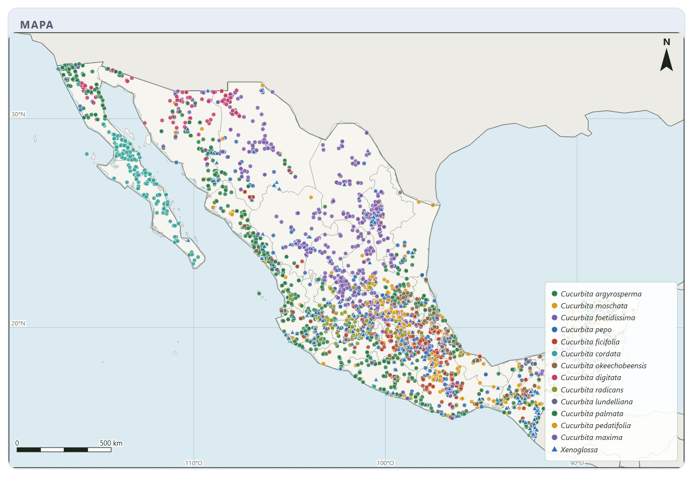
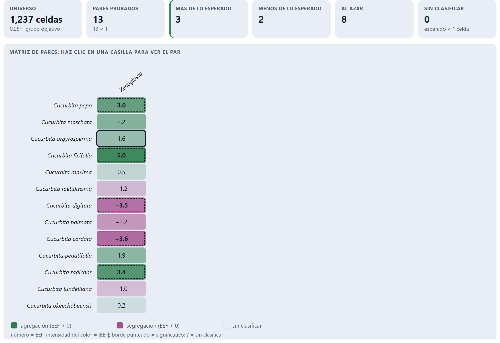
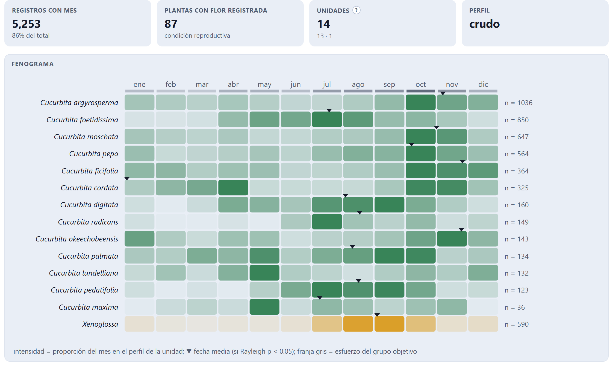
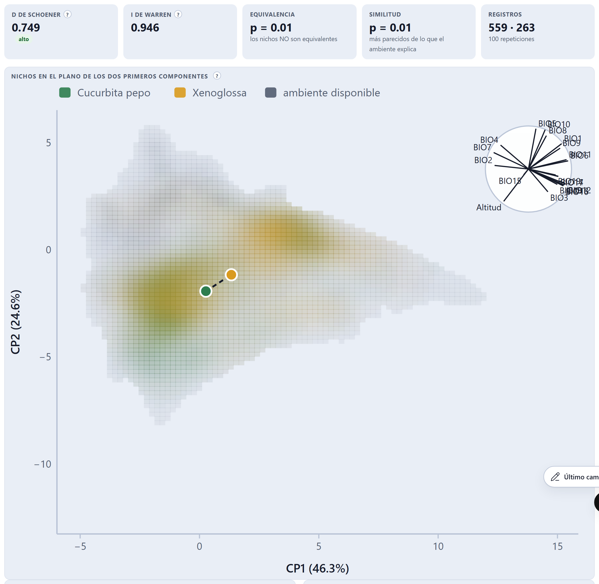
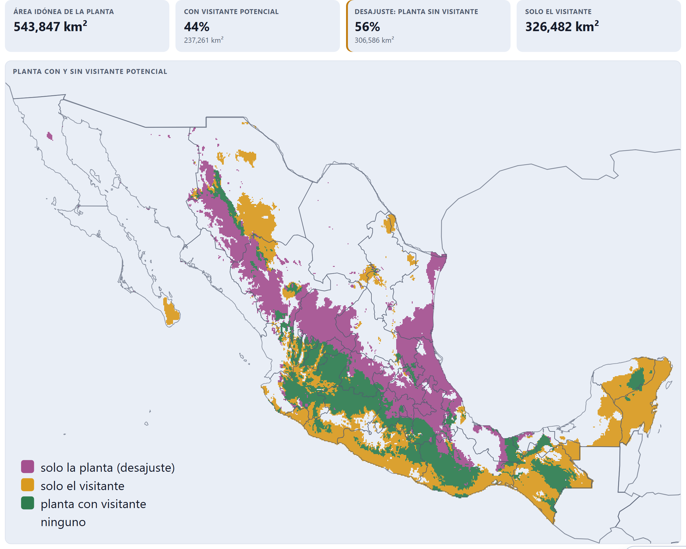

# Caso de estudio · Las calabazas y sus abejas en México

*English version: [README.md](README.md).*

¿Coinciden las abejas de las calabazas (*Xenoglossa*, incluido *Peponapis*) con las calabazas cultivadas y
silvestres (*Cucurbita*) de México en el espacio, en el tiempo y en el ambiente? Este caso recorre los diez
bloques de PollinationPro 1.2.3 con datos reales y públicos. Todo lo que aparece aquí salió de la app; las cifras
se pueden rehacer con los pasos de abajo.

## Datos

| Fuente | Qué | Cuánto |
|---|---|---|
| GBIF (10 de octubre de 2026) | Registros de presencia de 13 especies de *Cucurbita* y de los géneros *Xenoglossa* y *Peponapis* en México, con coordenadas y sin problemas geoespaciales | 10,254 registros (`gbif_ids.txt`) de 146 conjuntos de datos (`conjuntos_gbif.csv`) |
| Base de interacciones bióticas (10 de octubre de 2026) | Registros publicados de visitas a flores para la misma lista | 1,061 registros de 22 fuentes (`fuentes_interacciones.csv`) |
| WorldClim 2 | 19 variables bioclimáticas y altitud, agregadas de 30 segundos a 2.5 minutos de arco | 20 capas |

Los registros no se redistribuyen: `gbif_ids.txt` lista sus identificadores y `conjuntos_gbif.csv`, los conjuntos
que hay que citar.

**Cita de los registros.** GBIF.org (11 de octubre de 2026). *GBIF Occurrence Download*.
https://doi.org/10.15468/dl.nd3tcx. Es la descarga del portal con los mismos filtros (las 13 especies, los dos
géneros de abejas, México, con coordenadas y sin problemas geoespaciales): 10,247 registros de 152 conjuntos. La
diferencia con los 10,254 de la app (7 registros) viene de la lista taxonómica: el portal asigna los nombres con
Catalogue of Life y la app consulta la taxonomía base de GBIF.

Plantas: *C. pepo*, *C. moschata*, *C. argyrosperma*, *C. ficifolia* y *C. maxima* (domesticadas); *C. foetidissima*,
*C. digitata*, *C. palmata*, *C. cordata*, *C. pedatifolia*, *C. radicans*, *C. lundelliana* y *C. okeechobeensis*
(silvestres).

## Pasos y opciones

1. **Bloque 2.** La lista de arriba; país: México; `Descargar de GBIF` y `Buscar interacciones publicadas`.
2. **Bloque 3.** Reglas por omisión. Plantas cultivadas: *conservar* en las cinco domesticadas (aquí el cultivo es
   parte de la pregunta) y *quitar* en las silvestres. Sinónimo *Peponapis* → *Xenoglossa* activo.
3. **Bloques 4 a 6.** Opciones por omisión (celdas de 0.25°, universo del grupo objetivo, perfiles sin corregir).
4. **Bloque 7.** Las 20 capas; fondo a 200 km o menos de los registros; 100 repeticiones.
5. **Bloque 8.** Logística con fondo, umbral de máxima TSS, fondo del grupo objetivo; visitante: *Xenoglossa*.
6. **Bloque 9.** Solo interacciones publicadas, plantas de la lista, visitantes por género, 99 redes nulas.

## Resultados

**Depuración.** Quedan 6,077 registros: 5,423 de *Cucurbita* y 654 de *Xenoglossa*. Se quitan 3,410 duplicados,
415 en centroides, 185 imprecisos, 70 por tipo de registro, 52 cultivados de especies silvestres y 45 fuera de
México.

**Coocurrencia (Bloque 5).** En 1,237 celdas de 0.25°, *Xenoglossa* coincide más de lo esperado con *C. pepo*,
*C. ficifolia* y *C. radicans*, y menos de lo esperado con *C. digitata* y *C. cordata*, las calabazas del desierto
del noroeste. Con celdas de 0.5° (554 celdas) las cinco domesticadas coinciden más de lo esperado.

**Fenología (Bloque 6).** Los registros de *Xenoglossa* se concentran alrededor del 4 de septiembre (R̄ = 0.70).
El traslape de los perfiles mensuales va de D = 0.77 (*C. pedatifolia*) a 0.40 (*C. lundelliana*); entre las
domesticadas, *C. pepo* es la que más coincide (D = 0.62, desfase de 34 días).

**Nicho ambiental (Bloque 7).** Sobre un fondo de 101,454 celdas, los dos primeros componentes resumen 70.9 % de
la variación (46.3 % y 24.6 %). El nicho de *Xenoglossa* se parece al de las domesticadas de tierras bajas y
templadas y casi no toca el de las silvestres del desierto.

**Distribución potencial y desajuste (Bloque 8).** Los modelos de las domesticadas y de la abeja tienen un
desempeño modesto (AUC de validación 0.66 a 0.78); los de las silvestres de distribución restringida son mejores
(0.85 y 0.96). El área idónea para la planta sin abeja idónea crece de las domesticadas a las del desierto.

| Especie | Celdas (0.25°) | SES de coocurrencia | p ajustada | D fenológica | Desfase (días) | D de nicho | Área idónea sin abeja |
|---|---|---|---|---|---|---|---|
| *C. pepo* | 350 | 3.00 | 0.011 | 0.62 | 34 | 0.749 | 56 % de 543,847 km² |
| *C. moschata* | 361 | 2.15 | 0.076 | 0.54 | 58 | 0.700 | — |
| *C. argyrosperma* | 427 | 1.61 | 0.19 | 0.51 | 64 | 0.623 | 56 % de 555,034 km² |
| *C. ficifolia* | 169 | 4.98 | < 0.001 | 0.47 | 83 | 0.461 | — |
| *C. maxima* | 34 | 0.50 | 0.82 | 0.52 | 56 | 0.740 | — |
| *C. foetidissima* | 309 | −1.15 | 0.37 | 0.59 | 47 | 0.294 | 89 % de 764,314 km² |
| *C. digitata* | 66 | −3.46 | < 0.001 | 0.73 | 31 | 0.131 | — |
| *C. palmata* | 60 | −2.16 | 0.069 | 0.68 | 24 | 0.169 | — |
| *C. cordata* | 73 | −3.65 | < 0.001 | 0.42 | 121 | 0.092 | 96 % de 137,433 km² |
| *C. pedatifolia* | 55 | 1.93 | 0.15 | 0.77 | 18 | 0.258 | — |
| *C. radicans* | 65 | 3.42 | 0.009 | 0.62 | 17 | 0.379 | — |
| *C. lundelliana* | 51 | −1.00 | 0.52 | 0.40 | 141 | 0.191 | — |
| *C. okeechobeensis* | 52 | 0.16 | 1.00 | 0.46 | 82 | 0.464 | — |

*Xenoglossa* ocupa 181 celdas. El desajuste se calculó para cuatro especies; «—» indica que no se corrió.

**Red de interacciones (Bloque 9).** Los registros publicados dan una red de 7 especies de *Cucurbita* y 91 géneros
de visitantes con 126 vínculos (conectancia 0.198). Ni el anidamiento (NODF = 29.3; p = 0.30) ni la modularidad
(Q = 0.459; p = 0.88) difieren de los de redes al azar con los mismos totales. *Xenoglossa* es el género con más
registros (306 de 619) y el que visita más especies (6 de 7), seguido de *Apis* (5 especies, 47 registros). Como
son registros publicados y no conteos de visitas, la app no calcula H₂′ ni d′.

## Lectura

Las abejas de las calabazas siguen a las calabazas cultivadas: coinciden con ellas en el espacio más de lo que
explica el muestreo y ocupan un ambiente parecido. Con las silvestres del desierto del noroeste ocurre lo
contrario. Ese contraste puede ser biológico o de muestreo: hay pocas colectas de abejas en Baja California y
Sonora, y el universo del grupo objetivo descuenta el esfuerzo solo en parte. Los modelos de distribución de la
abeja son de desempeño modesto, así que el mapa de desajuste indica dónde buscar, no dónde falta el polinizador.

## Límites

- Son datos de solo presencia, con muestreo desigual; la ausencia de un registro no es ausencia de la especie.
- *Xenoglossa* se analiza como género; las especies de abeja tienen distribuciones distintas.
- Las fechas son de colecta u observación y no distinguen floración de fructificación.
- GBIF y la base de interacciones crecen: una consulta posterior traerá más registros que los de `gbif_ids.txt`.
